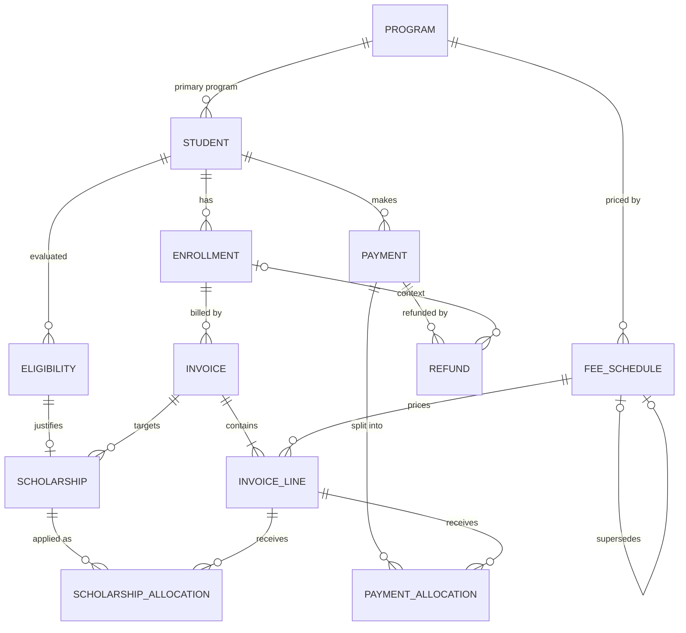

# Data dictionary

Field-level documentation of the eleven entities the YottaFlex challenge names, as they are
**implemented** (the Django models, their database constraints and the service-layer rules),
plus the supporting tables they depend on. The frozen design is
[`docs/DATABASE_DESIGN.md`](docs/DATABASE_DESIGN.md) v1.1. Where the implementation differs
from it, this file follows the implementation and says so.

`tests/architecture/test_data_dictionary.py` keeps this file true to the models: every concrete
field of the eleven entity models is listed exactly once, with its database type, nullability,
default, enumeration values, key and uniqueness as the code defines them.

> Location: this file is at the repository root at the project owner's instruction; the frozen
> ARCHITECTURE §3 layout places it under `docs/`.

## Contents

1. [Conventions](#1-conventions)
2. [Challenge names and model names](#2-challenge-names-and-model-names)
3. [ID conventions](#3-id-conventions)
4. [The eleven entities](#4-the-eleven-entities): Student, Program, FeeSchedule, Enrollment,
   Invoice, InvoiceLine, Scholarship, Eligibility, Payment, PaymentAllocation, Refund
5. [Supporting tables](#5-supporting-tables)
6. [Relationships and cardinality](#6-relationships-and-cardinality)
7. [Effective dates](#7-effective-dates)
8. [Lifecycle states and event history](#8-lifecycle-states-and-event-history)
9. [Derived values (computed, never stored)](#9-derived-values-computed-never-stored)
10. [Ground truth kept apart from the input features](#10-ground-truth-kept-apart-from-the-input-features)

## 1. Conventions

| Topic | Rule |
|---|---|
| Database | SQLite through the Django ORM; two databases: `default` (every table here) and `ground_truth` (labels only, §10). Table name = `<app>_<model>`. |
| DB type column | The type Django declares to SQLite (`varchar(n)`, `decimal`, `date`, `datetime`, `bool`, `smallint unsigned`, `text`). |
| Primary keys | A business-ID `varchar`, assigned once at insert by `core.ids` and never changed; a regex validator on every PK enforces its format (§3). No auto-increment `id`. |
| Foreign keys | Every relationship is a real FK with `on_delete=PROTECT`: nothing cascades, nothing is deleted. |
| Money | `decimal(12,2)`, Indian rupees (INR), signed by meaning (charges positive, credits negative in the ledger). SQLite stores `decimal` as floating point, so every money calculation is done in Python `Decimal` and rounded half-up to 2 places (ARCHITECTURE §8.3); the API sends money as strings (`"12500.00"`) and rejects more than 2 decimal places. |
| Dates | Business dates are `date` values inside calendar year 2026 (historical admit terms 2023–2025 excepted). |
| `recorded_at` | Every table has it: the system clock at insert (`auto_now_add`). It is execution metadata, **excluded from exports and checksums**, and never used by a business rule. |
| Required | "yes" = `NOT NULL` in the database. |
| Validation | **CK** = database `CHECK` / `UNIQUE` constraint (the database refuses the row). **SV** = enforced by the service layer before writing (API answers 400 / 409 / 422 with the rule ID). **REC** = re-checked by the reconciliation detector on stored data. |
| Stored / derived | Every column below is stored. Values computed on read (open amounts, balances, statuses' inputs) are listed in §9 and are never stored. |

## 2. Challenge names and model names

The model names are the challenge's names. Where the challenge's wording maps to more than one
table, the mapping is:

| Challenge term | Implementation |
|---|---|
| Student, Program, FeeSchedule, Enrollment, Invoice, InvoiceLine, Eligibility, Payment, PaymentAllocation, Refund | the model of the same name |
| Scholarship (an award) | `Scholarship` (`scholarships_scholarship`) |
| Scholarship criteria | `ScholarshipType` (supporting table, §5), linked to programs through the bridge `ScholarshipTypeProgram` |
| Scholarship applied to fees | `ScholarshipAllocation` (bridge Scholarship ↔ InvoiceLine, §5) |
| Academic term (`TERM-2026-FALL`) | `Term` (supporting table, §5) |
| Ledger, balance | `LedgerEntry` (§5); the balance is derived (§9) |
| Event history | `StudentStatusEvent`, `EnrollmentEvent`, `InvoiceEvent`, `ScholarshipEvent`, `RefundEvent` (§8) |
| `issue_type` / ground-truth label | `GroundTruthLabel` in the separate `ground_truth` database (§10) |

## 3. ID conventions

The six conventions the challenge requires, checked against the code (the PK's regex
validator) and against generated data (the starter export of seed 20261022, and the
`demo_workflow` run on it):

| Challenge convention | Implemented format | PK regex (model validator) | Generated example | Counter scope |
|---|---|---|---|---|
| `STU-000001` | `STU-{6}` | `STU-\d{6}` | `STU-000001` | global |
| `TERM-2026-FALL` | `TERM-{year}-{SEASON}` | `TERM-\d{4}-(SPRING\|SUMMER\|FALL)` | `TERM-2026-FALL` | natural key (year, season) |
| `INV-STU-<student-id>-2026-000001` | `INV-STU-{student number}-{year}-{6}` | `INV-STU-\d{6}-\d{4}-\d{6}` | `INV-STU-000001-2026-000001` | per student per year |
| `SCH-2026-000001` | `SCH-{year}-{6}` | `SCH-\d{4}-\d{6}` | `SCH-2026-000001` | per year |
| `PAY-2026-000001` | `PAY-{year}-{6}` | `PAY-\d{4}-\d{6}` | `PAY-2026-000001` | per year |
| `ALLOC-<payment-id>-01` | `ALLOC-{payment_id}-{2}` | `ALLOC-PAY-\d{4}-\d{6}-\d{2}` | `ALLOC-PAY-2026-000001-01` | per payment (≤ 99 rows, deallocations included) |

`<student-id>` in the invoice ID is the student's **6-digit number**: invoice
`INV-STU-000001-2026-000001` belongs to student `STU-000001`, so the student ID reads
inside the invoice ID; the detector checks that the number matches `invoice.student_id`
(REC). The other formats:

| Entity | Format | Example |
|---|---|---|
| Program | `PRG-{3}` | `PRG-004` |
| FeeSchedule | `FEE-{program}-{year}-{SEASON}-{FEE_TYPE}-{DOM\|INTL\|ALL}-V{n}` | `FEE-PRG-004-2026-FALL-TUITION-DOM-V1` |
| Enrollment | `ENR-{year}-{6}` | `ENR-2026-000001` |
| InvoiceLine | `{invoice_id}-L{2}` | `INV-STU-000001-2026-000001-L01` |
| Eligibility | `ELG-{year}-{6}` | `ELG-2026-000001` |
| Refund | `REF-{year}-{6}` | `REF-2026-000001` |
| ScholarshipType / bridge | `SCT-{3}` / `{type}-{program}` | `SCT-004` / `SCT-004-PRG-004` |
| ScholarshipAllocation | `SCHA-{scholarship_id}-{2}` | `SCHA-SCH-2026-000001-01` |
| LedgerEntry | `LED-{year}-{7}` | `LED-2026-0000001` |
| Status events | `EVT-{STU\|ENR\|INV\|SCH\|REF}-{year}-{7}` | `EVT-INV-2026-0000001` |
| BalanceSnapshot, ReconciliationRun, AnomalyFinding | `SNAP-{year}-{6}`, `RECON-{year}-{6}`, `FND-{year}-{6}` | `SNAP-2026-000001` |
| GenerationRun, GroundTruthLabel | `GEN-{year}-{4}`, `GT-{year}-{6}` | `GEN-2026-0001`, `GT-2026-000001` |

Counters are zero-padded, allocated inside the writing transaction from `core.IdSequence`,
never reused (a refused write releases its counter) and identical in the CSV, JSON and SQL
exports. The year segment is the business year; every business date is in 2026.
Evidence: `tests/core/test_ids.py` (formats, counters, release on rollback); on generated
data the detector's ID checks (`S-ID-DOMAIN`, `S-ID-GAPS-YEAR`, `S-ID-GAPS-PARENT`) raise no
finding: the generation's reconciliation run has 0 unexpected findings
(`tests/datagen/test_generate_starter.py::test_the_blind_run_and_the_evaluation_meet_every_target`);
`verify_export` checks every primary key and foreign key across the exported files
(`tests/datagen/test_verify_export.py`); `tests/architecture/test_data_dictionary.py` checks
every example above against its model's regex.

## 4. The eleven entities

Columns: **Field** (database column; `_id` = foreign key) · **Meaning** · **DB type** ·
**Required** · **Default** · **Allowed values / units** · **Key / uniqueness** ·
**Validation** · **Stored / derived**.

### Student (`students_student`)

A learner. Created only by `students.services.create_student` (API `POST /students/`); status
changes only through `change_status`, each writing a `StudentStatusEvent`.

| Field | Meaning | DB type | Required | Default | Allowed values / units | Key / uniqueness | Validation | Stored / derived |
|---|---|---|---|---|---|---|---|---|
| `student_id` | Business ID | `varchar(10)` | yes | — | `STU-\d{6}` | PK | regex; immutable | stored |
| `first_name` | Given name (synthetic) | `varchar(60)` | yes | — | text | — | CK not blank | stored |
| `last_name` | Family name (synthetic) | `varchar(60)` | yes | — | text | — | CK not blank | stored |
| `email` | Contact email | `varchar(120)` | yes | — | email on a reserved synthetic domain (`example.edu`) | unique | email format; CK not blank; SV allowed domain (`settings.STUDENT_EMAIL_DOMAINS`) | stored |
| `date_of_birth` | Birth date | `date` | yes | — | date | — | SV age 16–60 on the admit term's start date | stored |
| `residency` | Fee residency | `varchar(13)` | yes | — | `DOMESTIC`, `INTERNATIONAL` | — | CK enum | stored |
| `program_id` | Primary program | `varchar(7)` | yes | — | a Program | FK → Program (PROTECT) | SV program active | stored |
| `admit_term_id` | Admission term | `varchar(16)` | yes | — | a Term (billable or historical) | FK → Term (PROTECT) | SV ≤ the term of any enrollment | stored |
| `gpa` | Grade point average | `decimal` (3,2) | yes | — | 0.00–4.00 | — | CK range | stored |
| `need_index` | Financial need, higher = more need | `decimal` (3,2) | yes | — | 0.00–1.00 | — | CK range | stored |
| `status` | Lifecycle state (§8) | `varchar(12)` | yes | `ACTIVE` | `ACTIVE`, `ON_HOLD`, `WITHDRAWN`, `GRADUATED` | — | CK enum; SV transitions; changes only with an event | stored |
| `recorded_at` | System insert time | `datetime` | yes | set at insert | timestamp | — | not exported | stored (metadata) |

Indexes: (program, status), (status, residency). Only contact fields (`first_name`,
`last_name`, `email`) can be changed afterwards (`PATCH /students/{id}/`).

### Program (`academics_program`)

An academic programme. Master data: 20 in every generated dataset.

| Field | Meaning | DB type | Required | Default | Allowed values / units | Key / uniqueness | Validation | Stored / derived |
|---|---|---|---|---|---|---|---|---|
| `program_id` | Business ID | `varchar(7)` | yes | — | `PRG-\d{3}` | PK | regex | stored |
| `code` | Short code, e.g. `BSC-CS` | `varchar(12)` | yes | — | text | unique | CK not blank | stored |
| `name` | Programme name | `varchar(120)` | yes | — | text | — | CK not blank | stored |
| `level` | Award level | `varchar(8)` | yes | — | `UG`, `PG`, `DIPLOMA` | — | CK enum | stored |
| `department` | Owning department | `varchar(60)` | yes | — | text | — | CK not blank | stored |
| `is_stem` | STEM programme (STEM Award SCT-004 is limited to these through the bridge) | `bool` | yes | — | true / false (8 of 20 generated) | — | — | stored |
| `has_lab` | Charges a LAB fee (BR-FEE-04) | `bool` | yes | — | true / false (12 of 20 generated) | — | — | stored |
| `min_credits` | Fewest credits per term | `smallint unsigned` | yes | — | credits per term | — | CK 6 ≤ min ≤ max ≤ 24 | stored |
| `max_credits` | Most credits per term | `smallint unsigned` | yes | — | credits per term | — | CK 6 ≤ min ≤ max ≤ 24 | stored |
| `is_active` | Open for new students and enrollments | `bool` | yes | `True` | true / false | — | SV inactive programs refuse students and enrollments | stored |
| `recorded_at` | System insert time | `datetime` | yes | set at insert | timestamp | — | not exported | stored (metadata) |

### FeeSchedule (`billing_feeschedule`)

The price of one fee type for one program, term and residency, as one **immutable version**
(BR-FEE-03). A price change inserts version n+1 that `supersedes` version n.

| Field | Meaning | DB type | Required | Default | Allowed values / units | Key / uniqueness | Validation | Stored / derived |
|---|---|---|---|---|---|---|---|---|
| `fee_schedule_id` | Business ID (natural key + version) | `varchar(64)` | yes | — | §3 format | PK | regex | stored |
| `program_id` | Priced program | `varchar(7)` | yes | — | a Program | FK → Program (PROTECT) | — | stored |
| `term_id` | Priced term | `varchar(16)` | yes | — | a billable Term | FK → Term (PROTECT) | SV billable term | stored |
| `fee_type` | Kind of fee | `varchar(24)` | yes | — | `TUITION`, `LAB`, `REGISTRATION`, `TECHNOLOGY`, `LIBRARY`, `STUDENT_ACTIVITY`, `INTERNATIONAL_SERVICE` | unique with (program, term, residency, version) and with (program, term, residency, effective_from) | CK enum | stored |
| `residency` | Residency it applies to | `varchar(13)` | yes | — | `DOMESTIC`, `INTERNATIONAL`, `ALL` | part of both unique keys | CK enum; CK TUITION per residency, INTERNATIONAL_SERVICE = `INTERNATIONAL`, every other type `ALL` | stored |
| `charge_basis` | How quantity is set (BR-FEE-02) | `varchar(10)` | yes | — | `PER_CREDIT` (quantity = credits), `FLAT` (quantity = 1) | — | CK enum; CK TUITION is `PER_CREDIT` | stored |
| `amount` | Price | `decimal` (12,2) | yes | — | INR per credit (`PER_CREDIT`) or per term (`FLAT`) | — | CK ≥ 0 | stored |
| `is_scholarship_eligible` | Scholarships SCT-001…006 may cover it | `bool` | yes | — | true exactly for TUITION and LAB | — | CK flag by fee type | stored (fixed by type) |
| `is_refundable` | Credited on withdrawal (BR-WDR-02) | `bool` | yes | — | true exactly for TUITION and LAB | — | CK flag by fee type | stored (fixed by type) |
| `is_waivable` | May carry a waiver (BR-WAV-01) | `bool` | yes | — | true exactly for TECHNOLOGY, LIBRARY, STUDENT_ACTIVITY | — | CK flag by fee type | stored (fixed by type) |
| `allocation_priority` | Order in which money covers lines (BR-ALC-03) | `smallint unsigned` | yes | — | TUITION 10, LAB 20, REGISTRATION 30, TECHNOLOGY 40, LIBRARY 50, STUDENT_ACTIVITY 60, INTERNATIONAL_SERVICE 70 | — | CK priority by fee type | stored (fixed by type) |
| `version` | Version number in its chain | `smallint unsigned` | yes | — | 1, 2, … (≤ 99) | unique with (program, term, fee_type, residency) | CK ≥ 1; SV = predecessor + 1 | stored |
| `effective_from` | First day this version is in force | `date` | yes | — | date | unique with (program, term, fee_type, residency) | SV later than the predecessor's | stored |
| `supersedes_id` | The version this one replaces | `varchar(64)` | no | — | a FeeSchedule; null for version 1 | 1:1 FK → FeeSchedule (PROTECT), unique | CK set iff version > 1; SV same key, latest version | stored |
| `recorded_at` | System insert time | `datetime` | yes | set at insert | timestamp | — | not exported | stored (metadata) |

There is **no `effective_to` column** (DATABASE_DESIGN v1.1): a version is in force from its
`effective_from` until the day before the next version's (§7).

### Enrollment (`academics_enrollment`)

A student registered for one billable term.

| Field | Meaning | DB type | Required | Default | Allowed values / units | Key / uniqueness | Validation | Stored / derived |
|---|---|---|---|---|---|---|---|---|
| `enrollment_id` | Business ID | `varchar(15)` | yes | — | `ENR-\d{4}-\d{6}` | PK | regex | stored |
| `student_id` | Enrolled student | `varchar(10)` | yes | — | a Student | FK → Student (PROTECT); unique with term | SV admit term ≤ this term | stored |
| `program_id` | Program studied | `varchar(7)` | yes | — | a Program | FK → Program (PROTECT) | SV = the student's program, active | stored |
| `term_id` | Billable term | `varchar(16)` | yes | — | a billable Term | FK → Term (PROTECT); unique with student | SV billable (422 `TERM_NOT_BILLABLE`); one per student and term (409 `ENROLLMENT_EXISTS`) | stored |
| `credits` | Credits taken | `smallint unsigned` | yes | — | credits | — | CK ≥ 1; SV within the program's min–max (422 `CREDITS_OUT_OF_RANGE`) | stored |
| `status` | Lifecycle state (§8) | `varchar(10)` | yes | `ENROLLED` | `ENROLLED`, `WITHDRAWN`, `CANCELLED`, `COMPLETED` | — | CK enum; SV transitions | stored |
| `enrolled_on` | Registration date | `date` | yes | — | date | — | SV ≤ term start + 7 days | stored |
| `withdrawal_date` | Date of withdrawal | `date` | no | — | date | — | CK set iff `WITHDRAWN`; SV term start ≤ date ≤ term end, ≥ `enrolled_on` | stored |
| `cancellation_date` | Date of cancellation | `date` | no | — | date | — | CK set iff `CANCELLED`; SV `enrolled_on` ≤ date < term start | stored |
| `recorded_at` | System insert time | `datetime` | yes | set at insert | timestamp | — | not exported | stored (metadata) |

### Invoice (`billing_invoice`)

The bill for one enrollment. Its money amounts are **derived from its lines** (§9); only the
total at issue is stored.

| Field | Meaning | DB type | Required | Default | Allowed values / units | Key / uniqueness | Validation | Stored / derived |
|---|---|---|---|---|---|---|---|---|
| `invoice_id` | Business ID | `varchar(26)` | yes | — | `INV-STU-\d{6}-\d{4}-\d{6}` | PK | regex; REC student number = `student_id` | stored |
| `student_id` | Student billed | `varchar(10)` | yes | — | a Student | FK → Student (PROTECT) | SV = the enrollment's student | stored |
| `enrollment_id` | Enrollment billed | `varchar(15)` | yes | — | an Enrollment | FK → Enrollment (PROTECT); **no** DB unique | SV one invoice not `VOID` per enrollment (409 `DUPLICATE_INVOICE`, BR-INV-01); REC `DUPLICATE_INVOICE` | stored |
| `term_id` | Billed term | `varchar(16)` | yes | — | a Term | FK → Term (PROTECT) | SV = the enrollment's term | stored |
| `issue_date` | Issue date | `date` | yes | — | date | — | SV = term invoice date, or `enrolled_on` if later (BR-INV-03) | stored |
| `due_date` | Payment due date | `date` | yes | — | date | — | CK ≥ `issue_date`; SV = term due date | stored |
| `total_amount` | Σ net of FEE lines at issue | `decimal` (12,2) | yes | — | INR | — | CK ≥ 0; SV/REC = Σ FEE line net (BR-INV-02); never changed | stored (computed once at issue) |
| `lifecycle_status` | Lifecycle state (§8) | `varchar(10)` | yes | — | `ISSUED`, `CANCELLED`, `VOID` | — | CK enum; SV transitions (BR-INV-08) | stored |
| `collection_status` | Payment position, derived by BR-INV-06 | `varchar(20)` | yes | — | `UNPAID`, `PARTIALLY_PAID`, `OVERDUE`, `PAID`, `SCHOLARSHIP_COVERED`, `ADJUSTED_TO_ZERO` | — | CK enum; SV recalculated with every change (BR-INV-07); REC `INVOICE_STATUS_MISMATCH` | stored (derived, recorded with its date) |
| `collection_status_as_of` | Date the collection status was derived for | `date` | yes | — | date | — | SV set with every recalculation | stored |
| `currency` | Currency | `varchar(3)` | yes | `INR` | `INR` | — | CK = `INR` | stored |
| `recorded_at` | System insert time | `datetime` | yes | set at insert | timestamp | — | not exported | stored (metadata) |

The duplicate-invoice rule is deliberately **not** a database constraint, so the
`DUPLICATE_INVOICE` anomaly can be represented and detected (DATABASE_DESIGN §4).

### InvoiceLine (`billing_invoiceline`)

One line of an invoice. **Append-only**: a FEE line priced from a fee-schedule version, a
LATE_FEE line, or an ADJUSTMENT line that credits another line (withdrawal, cancellation, void).

| Field | Meaning | DB type | Required | Default | Allowed values / units | Key / uniqueness | Validation | Stored / derived |
|---|---|---|---|---|---|---|---|---|
| `line_id` | Business ID | `varchar(30)` | yes | — | `{invoice_id}-L\d{2}` | PK | regex | stored |
| `invoice_id` | Invoice | `varchar(26)` | yes | — | an Invoice | FK → Invoice (PROTECT) | — | stored |
| `line_type` | Kind of line | `varchar(10)` | yes | — | `FEE`, `LATE_FEE`, `ADJUSTMENT` | — | CK enum | stored |
| `fee_schedule_id` | Version that priced it | `varchar(64)` | no | — | a FeeSchedule | FK → FeeSchedule (PROTECT) | CK set iff `FEE`; SV the version in force on the term's invoice date for the program/term/residency (BR-FEE-01) | stored |
| `fee_type` | Fee type | `varchar(24)` | yes | — | `TUITION`, `LAB`, `REGISTRATION`, `TECHNOLOGY`, `LIBRARY`, `STUDENT_ACTIVITY`, `INTERNATIONAL_SERVICE`, `LATE_FEE` | — | CK enum; CK `LATE_FEE` iff line type `LATE_FEE` (adjustments carry the adjusted line's type) | stored |
| `description` | Text for statements | `varchar(120)` | yes | — | text | — | — | stored |
| `quantity` | Credits or 1 | `decimal` (6,2) | yes | — | credits (`PER_CREDIT`) or 1 | — | CK > 0; SV BR-FEE-02 | stored |
| `unit_amount` | Unit price | `decimal` (12,2) | yes | — | INR | — | CK ≥ 0 for FEE / LATE_FEE | stored |
| `gross_amount` | quantity × unit | `decimal` (12,2) | yes | — | INR | — | SV/REC = quantity × unit_amount (BR-FEE-02) | stored (computed at insert) |
| `waiver_amount` | Waived part | `decimal` (12,2) | yes | `0` | INR | — | CK ≥ 0; CK only on waivable FEE lines; SV ≤ gross (BR-WAV-01) | stored |
| `waiver_reason` | Why waived | `varchar(24)` | no | — | `STAFF_DEPENDENT`, `HARDSHIP`, `PG_ACTIVITY_EXEMPT`, `SPONSOR_AGREEMENT` | — | CK set iff waiver > 0; CK enum | stored |
| `net_amount` | gross − waiver (adjustments: the credit) | `decimal` (12,2) | yes | — | INR | — | CK ≥ 0 for FEE / LATE_FEE, < 0 for ADJUSTMENT; SV/REC = gross − waiver | stored (computed at insert) |
| `adjusts_line_id` | Line an adjustment credits | `varchar(30)` | no | — | an InvoiceLine of the same invoice | FK → InvoiceLine (PROTECT) | CK set iff `ADJUSTMENT`; SV target is FEE / LATE_FEE, Σ adjustments ≥ −target net | stored |
| `adjustment_reason` | Why adjusted | `varchar(24)` | no | — | `WITHDRAWAL`, `CANCELLATION`, `VOID` | — | CK set iff `ADJUSTMENT`, enum | stored |
| `is_scholarship_eligible` | Snapshot of the fee type's flag at issue | `bool` | yes | — | true / false | — | CK false unless FEE | stored (copied at issue) |
| `is_refundable` | Snapshot at issue | `bool` | yes | — | true / false | — | CK false unless FEE | stored (copied at issue) |
| `is_waivable` | Snapshot at issue | `bool` | yes | — | true / false | — | CK false unless FEE | stored (copied at issue) |
| `allocation_priority` | Snapshot at issue; 90 for late fees | `smallint unsigned` | yes | — | 10–70 by fee type, 90 for LATE_FEE | — | CK 90 for LATE_FEE | stored (copied at issue) |
| `posted_date` | Business date of the line | `date` | yes | — | date | — | SV ≥ invoice issue date | stored |
| `recorded_at` | System insert time | `datetime` | yes | set at insert | timestamp | — | not exported | stored (metadata) |

### Scholarship (`scholarships_scholarship`)

An award of one scholarship type to a student for one term, justified by one eligible
evaluation and targeted at one invoice. Its money reaches lines through
`ScholarshipAllocation` rows.

| Field | Meaning | DB type | Required | Default | Allowed values / units | Key / uniqueness | Validation | Stored / derived |
|---|---|---|---|---|---|---|---|---|
| `scholarship_id` | Business ID | `varchar(15)` | yes | — | `SCH-\d{4}-\d{6}` | PK | regex | stored |
| `student_id` | Recipient | `varchar(10)` | yes | — | a Student | FK → Student (PROTECT) | SV = the eligibility's student | stored |
| `scholarship_type_id` | Type (criteria) | `varchar(7)` | yes | — | a ScholarshipType | FK → ScholarshipType (PROTECT) | SV = the eligibility's type; one per exclusive group per term (409 `SCHOLARSHIP_GROUP_CONFLICT`, BR-SCH-05/08) | stored |
| `term_id` | Term | `varchar(16)` | yes | — | a Term | FK → Term (PROTECT) | SV = the eligibility's term | stored |
| `eligibility_id` | Evaluation that justifies it | `varchar(15)` | yes | — | an Eligibility with `is_eligible` true | 1:1 FK → Eligibility (PROTECT), unique | SV eligible, same student/type/term (BR-SCH-02) | stored |
| `invoice_id` | Invoice it covers | `varchar(26)` | yes | — | an `ISSUED` Invoice of the same student and term | FK → Invoice (PROTECT) | SV same student/term, lifecycle `ISSUED` | stored |
| `awarded_amount` | Amount awarded | `decimal` (12,2) | yes | — | INR | — | CK > 0; SV percent or fixed, capped per term (BR-SCH-03) and at the invoice's eligible fees (422 `SCHOLARSHIP_EXCEEDS_ELIGIBLE_FEES`, BR-SCH-04/08) | stored (computed at award) |
| `award_date` | Award date | `date` | yes | — | date | — | SV ≥ the eligibility's `evaluated_on` | stored |
| `status` | Lifecycle state (§8) | `varchar(18)` | yes | — | `OFFERED`, `ACCEPTED`, `APPLIED`, `PARTIALLY_REVERSED`, `REVOKED` | — | CK enum; SV transitions | stored |
| `recorded_at` | System insert time | `datetime` | yes | set at insert | timestamp | — | not exported | stored (metadata) |

### Eligibility (`scholarships_eligibility`)

One evaluation of one student against one scholarship type for one term (BR-SCH-01). Every
evaluation is kept, eligible or not; re-evaluations append.

| Field | Meaning | DB type | Required | Default | Allowed values / units | Key / uniqueness | Validation | Stored / derived |
|---|---|---|---|---|---|---|---|---|
| `eligibility_id` | Business ID | `varchar(15)` | yes | — | `ELG-\d{4}-\d{6}` | PK | regex | stored |
| `student_id` | Student evaluated | `varchar(10)` | yes | — | a Student | FK → Student (PROTECT) | — | stored |
| `scholarship_type_id` | Type evaluated | `varchar(7)` | yes | — | a ScholarshipType | FK → ScholarshipType (PROTECT) | — | stored |
| `term_id` | Term evaluated | `varchar(16)` | yes | — | a billable Term | FK → Term (PROTECT) | SV billable | stored |
| `evaluated_on` | Evaluation date | `date` | yes | — | date (generated: the term's invoice date) | — | — | stored |
| `is_eligible` | Outcome | `bool` | yes | — | true / false | — | calculator output (`scholarships.calculators`), never random | stored (computed at evaluation) |
| `reason_codes` | Why, criterion by criterion | `text` (JSON list) | yes | — | e.g. `["ALL_CRITERIA_MET"]`, `["GPA_BELOW_MIN", "NEED_BELOW_MIN"]` | — | JSON valid (CK) | stored (computed at evaluation) |
| `inputs_snapshot` | The inputs used (gpa, need_index, residency, program, first term) | `text` (JSON object) | yes | — | JSON | — | JSON valid (CK) | stored (audit snapshot) |
| `eligible_fee_base` | Σ net of the target invoice's lines coverable under the type's scope, if an invoice exists | `decimal` (12,2) | no | — | INR | — | CK ≥ 0 when set | stored (computed at evaluation) |
| `recorded_at` | System insert time | `datetime` | yes | set at insert | timestamp | — | not exported | stored (metadata) |

No unique constraint: the latest evaluation per (student, type, term) is current. Indexes:
(student, scholarship_type, term, evaluated_on), (term, is_eligible).

### Payment (`payments_payment`)

Money received for a student from any payer. Credited to the ledger in full on receipt
(BR-PAY-02); allocation to lines is separate. Never edited or deleted.

| Field | Meaning | DB type | Required | Default | Allowed values / units | Key / uniqueness | Validation | Stored / derived |
|---|---|---|---|---|---|---|---|---|
| `payment_id` | Business ID | `varchar(15)` | yes | — | `PAY-\d{4}-\d{6}` | PK | regex | stored |
| `student_id` | Student credited | `varchar(10)` | yes | — | a Student | FK → Student (PROTECT) | — | stored |
| `amount` | Amount received | `decimal` (12,2) | yes | — | INR | — | CK > 0 (BR-PAY-01) | stored |
| `currency` | Currency | `varchar(3)` | yes | `INR` | `INR` | — | CK = `INR` | stored |
| `received_date` | Date received | `date` | yes | — | 2026 date | — | SV on or after the student's first invoice issue date (400) | stored |
| `method` | Payment method | `varchar(16)` | yes | — | `UPI`, `CARD`, `BANK_TRANSFER`, `CHEQUE`, `CASH`, `SPONSOR_TRANSFER` | — | CK enum | stored |
| `payer_type` | Who paid; every payer counts as money paid (BR-PAY-03) | `varchar(10)` | yes | — | `SELF`, `GUARDIAN`, `SPONSOR` | — | CK enum | stored |
| `payer_name` | Payer's name (synthetic) | `varchar(80)` | no | — | text | — | — | stored |
| `external_reference` | Bank / gateway reference (idempotency key) | `varchar(40)` | yes | — | text | unique | 409 `DUPLICATE_PAYMENT` on resubmission (BR-PAY-01) | stored |
| `status` | Posting state | `varchar(10)` | yes | `POSTED` | `POSTED` | — | CK enum | stored |
| `recorded_at` | System insert time | `datetime` | yes | set at insert | timestamp | — | not exported | stored (metadata) |

`method` is `varchar(16)` in the implementation (DATABASE_DESIGN v1.1 lists Char(14); the
longest value, `SPONSOR_TRANSFER`, has 16 characters). Available amount and allocation state
are derived (§9).

### PaymentAllocation (`payments_paymentallocation`)

Bridge Payment ↔ InvoiceLine (N:M). **Append-only**: money is placed on a line by an
`ALLOCATE` row and released by a `DEALLOCATE` row that references it (BR-ALC-05).

| Field | Meaning | DB type | Required | Default | Allowed values / units | Key / uniqueness | Validation | Stored / derived |
|---|---|---|---|---|---|---|---|---|
| `allocation_id` | Business ID | `varchar(24)` | yes | — | `ALLOC-{payment_id}-\d{2}` | PK | regex; ≤ 99 per payment (409 `ALLOCATION_LIMIT_REACHED`) | stored |
| `payment_id` | Payment allocated | `varchar(15)` | yes | — | a Payment | FK → Payment (PROTECT) | SV Σ net allocations ≤ payment amount − refunds not rejected (422 `ALLOCATION_EXCEEDS_PAYMENT`, BR-ALC-01) | stored |
| `invoice_line_id` | Line covered | `varchar(30)` | yes | — | a FEE or LATE_FEE InvoiceLine | FK → InvoiceLine (PROTECT) | SV same student (422 `ALLOCATION_STUDENT_MISMATCH`); ≤ the line's open amount (422 `ALLOCATION_EXCEEDS_LINE_OPEN`, BR-ALC-02) | stored |
| `allocation_type` | Direction | `varchar(10)` | yes | — | `ALLOCATE`, `DEALLOCATE` | — | CK enum | stored |
| `amount` | Amount (signed) | `decimal` (12,2) | yes | — | INR; > 0 for ALLOCATE, < 0 for DEALLOCATE | — | CK sign by type | stored |
| `reverses_id` | ALLOCATE row a deallocation releases | `varchar(24)` | no | — | a PaymentAllocation | FK → PaymentAllocation (PROTECT) | CK set iff `DEALLOCATE`; SV same line, Σ deallocations ≥ −original | stored |
| `rule_applied` | Why the row exists (audit) | `varchar(22)` | yes | — | `AUTO_OLDEST_FIRST`, `MANUAL`, `WITHDRAWAL_RELEASE`, `CANCELLATION_RELEASE`, `SCHOLARSHIP_PRECEDENCE` | — | CK enum | stored |
| `allocated_on` | Business date | `date` | yes | — | date | — | SV ≥ the payment's `received_date` | stored |
| `recorded_at` | System insert time | `datetime` | yes | set at insert | timestamp | — | not exported | stored (metadata) |

Allocations post nothing to the ledger (BR-LED-01): the payment was credited when received.

### Refund (`payments_refund`)

Money returned to the payer of a source payment. Lifecycle REQUESTED → APPROVED → PROCESSED (or
REJECTED); the ledger is debited only on PROCESSED (BR-REF-03).

| Field | Meaning | DB type | Required | Default | Allowed values / units | Key / uniqueness | Validation | Stored / derived |
|---|---|---|---|---|---|---|---|---|
| `refund_id` | Business ID | `varchar(15)` | yes | — | `REF-\d{4}-\d{6}` | PK | regex | stored |
| `student_id` | Student | `varchar(10)` | yes | — | a Student | FK → Student (PROTECT) | SV = the payment's student | stored |
| `payment_id` | Source payment | `varchar(15)` | yes | — | a Payment | FK → Payment (PROTECT) | SV refund ≤ the payment's available amount (422 `REFUND_EXCEEDS_PAYMENT_AVAILABLE`, BR-REF-02) | stored |
| `payer_type` | Who receives it: the source payment's payer | `varchar(10)` | yes | — | `SELF`, `GUARDIAN`, `SPONSOR` | — | CK enum; SV copied from the payment (BR-REF-04) | stored (copied) |
| `enrollment_id` | Enrollment exited, for exit refunds | `varchar(15)` | no | — | a `WITHDRAWN` / `CANCELLED` Enrollment | FK → Enrollment (PROTECT) | CK set iff reason `WITHDRAWAL` / `CANCELLATION`; SV enrollment in the matching state | stored |
| `reason` | Why refunded | `varchar(14)` | yes | — | `WITHDRAWAL`, `CANCELLATION`, `OVERPAYMENT` | — | CK enum | stored |
| `amount` | Amount refunded | `decimal` (12,2) | yes | — | INR | — | CK > 0; SV ≤ net paid (422 `REFUND_EXCEEDS_NET_PAID`, BR-REF-01), ≤ credit balance (422 `REFUND_EXCEEDS_CREDIT_BALANCE`, BR-REF-02), checked at request, approval and processing | stored |
| `requested_date` | Request date | `date` | yes | — | date | — | SV ≥ the payment's `received_date` | stored |
| `processed_date` | Processing date | `date` | no | — | date | — | CK set iff `PROCESSED`, ≥ `requested_date`, ≤ 2026-12-31 | stored |
| `status` | Lifecycle state (§8) | `varchar(10)` | yes | — | `REQUESTED`, `APPROVED`, `PROCESSED`, `REJECTED` | — | CK enum; SV transitions (409 `ILLEGAL_TRANSITION`, BR-REF-03) | stored |
| `calculation` | Request-time audit snapshot (net paid, credit balance, payment available, schedule %) | `text` (JSON object) | yes | — | JSON | — | JSON valid (CK); never rewritten | stored (audit snapshot) |
| `recorded_at` | System insert time | `datetime` | yes | set at insert | timestamp | — | not exported | stored (metadata) |

## 5. Supporting tables

Not among the eleven named entities, but every relationship above depends on them. Field-level
detail is in `docs/DATABASE_DESIGN.md` §3; the keys and roles are:

| Table | Role | PK | Foreign keys | Notes |
|---|---|---|---|---|
| `academics_term` (Term) | Academic term | `term_id` `TERM-{year}-{SEASON}` | — | unique (year, season); `is_billable` true only for the three 2026 terms; invoice ≤ due, start < census < end; `late_fee_grace_days` default 14 |
| `scholarships_scholarshiptype` (ScholarshipType) | Scholarship **criteria**: GPA / need thresholds, residency, first-term, program restriction, award basis and value, cap per term, exclusive group, priority, `effective_from` / `effective_to` | `scholarship_type_id` `SCT-{3}` | — | 7 types; only `SCT-007` (full ride) covers all fee lines |
| `scholarships_scholarshiptypeprogram` | **Bridge** ScholarshipType ↔ Program (N:M) | `id` `{type}-{program}` | → ScholarshipType, → Program | unique (scholarship_type, program) |
| `scholarships_scholarshipallocation` | **Bridge** Scholarship ↔ InvoiceLine (N:M), append-only | `allocation_id` `SCHA-{scholarship_id}-{2}` | → Scholarship, → InvoiceLine, → self (`reverses`) | `APPLY` > 0 / `REVERSE` < 0; reason `AWARD` / `WITHDRAWAL` / `CANCELLATION` |
| `billing_ledgerentry` (LedgerEntry) | Student ledger, one entry per source row (BR-LED-01) | `entry_id` `LED-{year}-{7}` | → Student; exactly one of → InvoiceLine, → ScholarshipAllocation, → Payment, → Refund (each 1:1, unique) | entry type `CHARGE`, `LATE_FEE`, `ADJUSTMENT`, `SCHOLARSHIP_CREDIT`, `SCHOLARSHIP_REVERSAL`, `PAYMENT`, `REFUND`; sign checked by type |
| `*_*event` (5 tables) | Event history (§8) | `event_id` `EVT-…` | → the entity | `from_status`, `to_status`, `event_date`, `reason`, `actor`, `source_ref`; `InvoiceEvent.dimension` = `LIFECYCLE` / `COLLECTION` |
| `reconciliation_balancesnapshot` | Reported balance at a date, checked against the ledger (BR-BAL-03) | `snapshot_id` `SNAP-{year}-{6}` | → Student | unique (student, as_of_date) |
| `reconciliation_reconciliationrun`, `reconciliation_anomalyfinding` | Detector runs and findings (outputs, never inputs) | `RECON-…`, `FND-…` | run → Student (optional, STUDENT scope); finding → run, → Student (optional) | findings never reference ground truth |
| `core_idsequence` | ID counters | `key` | — | internal; not exported |
| `datagen_generationrun` | Generation metadata (seed, scale, config hash, row counts, checksums, git SHA) | `run_id` `GEN-{year}-{4}` | — | not exported as dataset |
| `datagen_groundtruthlabel` (**`ground_truth` database**) | Anomaly labels (§10) | `label_id` `GT-{year}-{6}` | none (plain IDs) | exported only to `ground_truth/` |

## 6. Relationships and cardinality

Every relationship is a foreign key (`PROTECT`), except the ground-truth label's plain IDs
(§10) and the polymorphic `record_id` of findings and labels (a business ID of any entity, by
design).

| Parent → child | Cardinality | Optional side | Bridge / notes |
|---|---|---|---|
| Program → Student | 1:N | every student has one program | |
| Term → Student (`admit_term`) | 1:N | | billable or historical term |
| Student → Enrollment | 1:0..3 | a student may have no enrollment | one per billable term (unique student, term) |
| Program → Enrollment; Term → Enrollment | 1:N | | |
| Program → FeeSchedule; Term → FeeSchedule | 1:N | | |
| FeeSchedule → FeeSchedule (`supersedes`) | 1:0..1 | version 1 supersedes nothing | linear version chain (unique) |
| Enrollment → Invoice | 1:0..1 valid | an enrollment has no invoice until one is generated | a second non-VOID invoice is the `DUPLICATE_INVOICE` anomaly |
| Student → Invoice; Term → Invoice | 1:N | | |
| Invoice → InvoiceLine | 1:1..N | | at least one FEE line |
| FeeSchedule → InvoiceLine | 1:0..N | null for LATE_FEE / ADJUSTMENT lines | |
| InvoiceLine → InvoiceLine (`adjusts_line`) | 1:0..N | | adjustments credit a FEE / LATE_FEE line |
| ScholarshipType ↔ Program | **N:M** | | bridge `ScholarshipTypeProgram` |
| Student × ScholarshipType × Term → Eligibility | 1:1..N | | exactly one per combination in generated data (210,000 at full scale) |
| Eligibility → Scholarship | **1:0..1** | most evaluations have no award | unique `eligibility_id` |
| Student / ScholarshipType / Term / Invoice → Scholarship | 1:0..N | | |
| Scholarship ↔ InvoiceLine | **N:M** | an award may be unapplied | bridge `ScholarshipAllocation` |
| Student → Payment | 1:0..N | | |
| Payment ↔ InvoiceLine | **N:M** | a payment may be unallocated (credit) | bridge `PaymentAllocation` |
| PaymentAllocation → PaymentAllocation (`reverses`) | 1:0..N | | deallocations |
| Payment → Refund | 1:0..N | | |
| Enrollment → Refund | 1:0..N | `enrollment` null for OVERPAYMENT refunds | |
| Source row → LedgerEntry | 1:1 (refund 1:0..1 until PROCESSED; payment allocations none) | | BR-LED-01 |
| Student → LedgerEntry, BalanceSnapshot | 1:N | | |
| Lifecycle entity → its event table | 1:1..N | | the first event is written at creation |

## 7. Effective dates

| Where | Behaviour |
|---|---|
| FeeSchedule `effective_from` + `version` + `supersedes` | Each version is in force from its `effective_from` until the day before the next version's `effective_from`, the latest open-ended. Rows are never updated; a new version must start later than its predecessor, so windows never overlap or leave gaps (BR-FEE-03). An invoice is priced from the versions **in force on the term's invoice date** (BR-FEE-01). `GET /fee-schedules/{id}/history/` returns the chain with its derived windows. Generated data has V2 revisions of FALL tuition effective 1 Aug 2026. |
| ScholarshipType `effective_from` / `effective_to` | A type is evaluated for terms within its window; it is immutable once referenced by an evaluation (a criteria change is a new type ID). |
| Term dates | `invoice_date` (issue), `due_date` (overdue from the next day, BR-INV-06), `start_date` (cancellation before it, withdrawal on/after it), `census_date` = start + 28 (withdrawal day 28 = 0 % credit, BR-WDR-02), `end_date`; late fee posted the day after `due_date + late_fee_grace_days` (BR-LATE-01). |
| Invoice `collection_status_as_of` | The date the stored collection status was derived for (BR-INV-07). |

## 8. Lifecycle states and event history

Transitions are defined once in each app's `lifecycle.py`; the services check them (409
`ILLEGAL_TRANSITION` otherwise) and write one event row per change; the reconciliation
lifecycle check replays every event chain.

| Entity | Allowed transitions (from `lifecycle.py`) | Event table |
|---|---|---|
| Student | ∅→ACTIVE; ACTIVE→ON_HOLD, WITHDRAWN, GRADUATED; ON_HOLD→ACTIVE (WITHDRAWN, GRADUATED terminal) | `students_studentstatusevent` |
| Enrollment | ∅→ENROLLED; ENROLLED→WITHDRAWN (on/after start), CANCELLED (before start), COMPLETED (terminal states) | `academics_enrollmentevent` |
| Invoice, lifecycle | ∅→ISSUED; ISSUED→CANCELLED, VOID (VOID only with no net allocations; both terminal) | `billing_invoiceevent` (`dimension = LIFECYCLE`) |
| Invoice, collection | ∅→UNPAID, then only to the status BR-INV-06 derives (deallocations can move it back, e.g. PAID→PARTIALLY_PAID); ADJUSTED_TO_ZERO permanently after VOID | `billing_invoiceevent` (`dimension = COLLECTION`) |
| Scholarship | ∅→OFFERED→ACCEPTED→APPLIED→PARTIALLY_REVERSED; OFFERED / ACCEPTED / APPLIED / PARTIALLY_REVERSED→REVOKED | `scholarships_scholarshipevent` |
| Refund | ∅→REQUESTED→APPROVED→PROCESSED; REQUESTED / APPROVED→REJECTED | `payments_refundevent` |
| FeeSchedule, InvoiceLine, Payment, PaymentAllocation, ScholarshipAllocation, LedgerEntry | none: append-only rows; history is the rows themselves (versions, adjustments, deallocations, reversals) | — |

Event columns: `event_id`, `from_status` (null for the first event), `to_status`, `event_date`
(never before the previous event of the same record), `reason` (e.g. `CREATED`,
`PAYMENT_ALLOCATED`, `WITHDRAWAL`, `DUE_DATE_PASSED`), `actor`, `source_ref` (the business ID
that caused it). History is never overwritten (financial tables are never updated; editing
endpoints answer 405).

## 9. Derived values (computed, never stored)

| Value | Definition | Where computed |
|---|---|---|
| Invoice `original_charges` | Σ net of FEE + LATE_FEE lines | `billing.calculators.invoice_amounts` (BR-INV-04) |
| Invoice `adjustments` | Σ ADJUSTMENT lines (≤ 0) | same |
| Invoice `net_charges` | original_charges + adjustments | same |
| Invoice `scholarship_applied` | Σ ScholarshipAllocation (APPLY + REVERSE, signed) | same |
| Invoice `amount_paid`, `payments_by_payer` | Σ PaymentAllocation (ALLOCATE + DEALLOCATE, signed), by payer | same |
| Invoice `outstanding`, `is_settled` | net_charges − scholarship_applied − amount_paid (≥ 0); settled = outstanding 0 (BR-INV-05) | same |
| Invoice `collection_status` inputs | BR-INV-06 from the amounts, `due_date` and the as-of date | `billing.calculators.collection_status` (the result is stored with its date) |
| Line open amount | net + Σ adjustments of the line − scholarship on it − payments on it (≥ 0) | BR-ALC-02 |
| Payment available, allocation state | amount − Σ net allocations − Σ refunds not REJECTED; `UNALLOCATED` / `PARTIAL` / `FULL` | `payments.calculators` |
| Student ledger balance | Σ LedgerEntry.amount with entry_date ≤ as_of (negative = credit) | BR-BAL-01 |
| Unallocated credit; BR-BAL-02 identity | Σ payments − Σ net allocations − Σ processed refunds; balance = Σ outstanding − unallocated credit | `GET /students/{id}/balance/` |
| Net paid, credit balance, refundable | BR-REF-01/02 inputs | `GET /students/{id}/refundable/` |
| Fee-schedule windows | from each version's `effective_from` to the day before the next one's | `billing.calculators.effective_windows` |

## 10. Ground truth kept apart from the input features

The five injected anomaly types (payment allocated beyond amount, scholarship exceeding eligible
fees, invoice generated twice, refund exceeding net paid, balance disagreeing with the ledger)
are labelled in **`GroundTruthLabel`**, which:

- lives only in the separate **`ground_truth` SQLite database** (`config.routers.GroundTruthRouter`
  routes it there and nothing else);
- references dataset rows by **plain IDs** (`generation_run_id`, `record_id`, `student_id`,
  `related_ids`), never by foreign keys, and no dataset table has a column pointing back to it;
- is read only by the evaluation (`datagen/evaluation.py`) and written only by the generator;
  `tests/datagen/test_isolation.py` fails if any other module names it, and the detector
  (`reconciliation/`) imports nothing from `datagen`;
- is exported only to `ground_truth/ground_truth.csv` and `.json`, never under `dataset/`;
  `verify_export` (check `separation`) fails if a label table, a label-only column
  (`label_id`, `injection_method`, `expected_decision`, `rule_violated`, `expected_value`,
  `injected_value`) or a `GT-` ID appears anywhere under `dataset/`.

| Label field | Meaning |
|---|---|
| `label_id` | `GT-{year}-{6}` |
| `generation_run_id` | the generation run that injected it |
| `issue_type` | one of the five required types |
| `entity_type`, `record_id` | the anomalous row (payment, scholarship, the later duplicate invoice, refund, snapshot) |
| `student_id`, `related_ids` | the student and the other rows involved |
| `rule_violated` | the business rule it breaks |
| `injection_method` | `APPEND` (new rows) or `MODIFY` (a labelled snapshot only) |
| `expected_value`, `injected_value` | the correct and the injected amount, when one applies |
| `expected_decision` | `REJECT_ALLOCATION`, `CAP_SCHOLARSHIP`, `VOID_DUPLICATE`, `REVERSE_REFUND`, `RESTATE_BALANCE`, `INVESTIGATE` |
| `recorded_at` | system insert time (not exported) |

Generation creates a valid baseline first, then injects labelled rows; unrelated rows are not
touched (0 unexpected findings at starter and full scale), and the evaluation measures the
blind detector's findings against these labels (precision, recall, F1 per type).
