# Student Finance Backend — Database Design

**Design v1.1, ready to freeze.** Companion to `ARCHITECTURE.md` v1.1. SQLite through the Django ORM. One Django model per table; the table name is `<app>_<model>`.

### Change log
| Version | Changes |
|---|---|
| v1.0 | Initial baseline + patches (eligibility count, invoice statuses, full-ride `coverage_scope`). |
| **v1.1** | Invoice `lifecycle_status` / `collection_status` split + `collection_status_as_of`; InvoiceEvent `dimension`; `VOID` adjustment reason; FeeSchedule `effective_to` removed (derived), `supersedes` unique; Term `is_billable` + 9 historical admit terms; 2026 calendar moved inside the calendar year; arithmetic CHECKs moved to service/reconciliation (SQLite REAL); CHARGE may be 0; Refund `payer_type`; new allocation `rule_applied` values; GroundTruthLabel moved to its own database; `recorded_at` system timestamps excluded from exports; ID lengths re-verified (FeeSchedule ID → Char(64)); full ERD, uniqueness and cardinality catalogue; exact baseline vs injected volumes. |

### Conventions
- **PK** is a business ID `CharField` (immutable, assigned once at insert by `core.ids`). Django's auto `id` isn't used.
- **Money:** `DecimalField(max_digits=12, decimal_places=2)`, INR. SQLite stores these as REAL, so all money arithmetic happens in Python `Decimal` (ARCHITECTURE §8.3). Signs: charges positive; ledger credits negative.
- **Dates:** every business event has a business `Date` (inside 2026). Every table also has **`recorded_at`** (DateTime, system clock). It's execution metadata, **excluded from exports and checksums**. Financial tables have no `updated_at` because they're never updated.
- `Req` = required (`NOT NULL`). `U` = unique. `→` = foreign key (`on_delete=PROTECT` everywhere; nothing cascades).
- **CK** = DB `CheckConstraint(condition=…)`, limited to signs, ranges and required-iff rules (no arithmetic equalities). **SV** = enforced in the service layer. **REC** = re-checked by reconciliation. Every SV rule is also REC.

---

## 1. Entity-relationship diagram

```mermaid
erDiagram
    PROGRAM ||--o{ STUDENT : "primary program"
    TERM ||--o{ STUDENT : "admit term"
    STUDENT ||--|{ STUDENT_STATUS_EVENT : has
    STUDENT ||--o{ ENROLLMENT : has
    PROGRAM ||--o{ ENROLLMENT : in
    TERM ||--o{ ENROLLMENT : "billable term"
    ENROLLMENT ||--|{ ENROLLMENT_EVENT : has
    PROGRAM ||--o{ FEE_SCHEDULE : priced_by
    TERM ||--o{ FEE_SCHEDULE : priced_for
    FEE_SCHEDULE |o--o| FEE_SCHEDULE : "supersedes (next version)"
    ENROLLMENT ||--o{ INVOICE : "billed by (1 non-void; more = anomaly)"
    STUDENT ||--o{ INVOICE : owes
    TERM ||--o{ INVOICE : for
    INVOICE ||--|{ INVOICE_LINE : contains
    INVOICE ||--|{ INVOICE_EVENT : has
    FEE_SCHEDULE ||--o{ INVOICE_LINE : prices
    INVOICE_LINE ||--o{ INVOICE_LINE : "adjusted by"
    SCHOLARSHIP_TYPE ||--o{ SCHOLARSHIP_TYPE_PROGRAM : limits
    PROGRAM ||--o{ SCHOLARSHIP_TYPE_PROGRAM : eligible
    STUDENT ||--o{ ELIGIBILITY : evaluated
    SCHOLARSHIP_TYPE ||--o{ ELIGIBILITY : criteria
    TERM ||--o{ ELIGIBILITY : for
    ELIGIBILITY ||--o| SCHOLARSHIP : justifies
    STUDENT ||--o{ SCHOLARSHIP : receives
    SCHOLARSHIP_TYPE ||--o{ SCHOLARSHIP : "awarded as"
    TERM ||--o{ SCHOLARSHIP : for
    INVOICE ||--o{ SCHOLARSHIP : targets
    SCHOLARSHIP ||--o{ SCHOLARSHIP_ALLOCATION : applied_as
    INVOICE_LINE ||--o{ SCHOLARSHIP_ALLOCATION : receives
    SCHOLARSHIP_ALLOCATION ||--o{ SCHOLARSHIP_ALLOCATION : "reversed by"
    SCHOLARSHIP ||--|{ SCHOLARSHIP_EVENT : has
    STUDENT ||--o{ PAYMENT : makes
    PAYMENT ||--o{ PAYMENT_ALLOCATION : split_into
    INVOICE_LINE ||--o{ PAYMENT_ALLOCATION : receives
    PAYMENT_ALLOCATION ||--o{ PAYMENT_ALLOCATION : "deallocated by"
    PAYMENT ||--o{ REFUND : refunded_by
    STUDENT ||--o{ REFUND : receives
    ENROLLMENT |o--o{ REFUND : "withdrawal/cancellation context"
    REFUND ||--|{ REFUND_EVENT : has
    STUDENT ||--o{ LEDGER_ENTRY : account
    INVOICE_LINE |o--o| LEDGER_ENTRY : "posts (charge/late fee/adjustment)"
    SCHOLARSHIP_ALLOCATION |o--o| LEDGER_ENTRY : "posts (credit/reversal)"
    PAYMENT |o--o| LEDGER_ENTRY : "posts (payment)"
    REFUND |o--o| LEDGER_ENTRY : "posts (refund, when processed)"
    STUDENT ||--o{ BALANCE_SNAPSHOT : reported
    STUDENT |o--o{ RECONCILIATION_RUN : "scope (optional)"
    RECONCILIATION_RUN ||--o{ ANOMALY_FINDING : produces
    STUDENT |o--o{ ANOMALY_FINDING : about
    GENERATION_RUN ||..o{ GROUND_TRUTH_LABEL : "injected (cross-DB id, not FK)"
```



`GROUND_TRUTH_LABEL` lives in the separate `ground_truth` database (ARCHITECTURE §12.2). Its links to other rows are plain IDs, never FKs.

---

## 2. ID conventions (verified against the brief)

| Entity | Format | Example | Length / field | Counter scope | Brief |
|---|---|---|---|---|---|
| Student | `STU-{6}` | `STU-000001` | 10 / Char(10) | global | ✓ `STU-000001` |
| Term | `TERM-{year}-{SEASON}` | `TERM-2026-FALL` | ≤ 16 / Char(16) | natural key | ✓ `TERM-2026-FALL` |
| Invoice | `INV-STU-{student 6}-{year}-{6}` | `INV-STU-000001-2026-000001` | 26 / Char(26) | per student per year | ✓ `INV-STU-<student-id>-2026-000001` (D2) |
| Scholarship (award) | `SCH-{year}-{6}` | `SCH-2026-000001` | 15 / Char(15) | per year | ✓ `SCH-2026-000001` |
| Payment | `PAY-{year}-{6}` | `PAY-2026-000001` | 15 / Char(15) | per year | ✓ `PAY-2026-000001` |
| PaymentAllocation | `ALLOC-{payment_id}-{2}` | `ALLOC-PAY-2026-000001-01` | 24 / Char(24) | per payment (≤ 99, incl. deallocations) | ✓ `ALLOC-<payment-id>-01` |
| Program | `PRG-{3}` | `PRG-004` | 7 / Char(7) | global | added |
| FeeSchedule | `FEE-{program}-{year}-{SEASON}-{FEE_TYPE}-{DOM\|INTL\|ALL}-V{n}` | `FEE-PRG-004-2026-FALL-TUITION-DOM-V1` | ≤ 54 / **Char(64)** | natural key + version | added |
| Enrollment | `ENR-{year}-{6}` | `ENR-2026-000001` | 15 / Char(15) | per year | added |
| InvoiceLine | `{invoice_id}-L{2}` | `INV-STU-000001-2026-000001-L03` | 30 / Char(30) | per invoice (≤ 99) | added |
| ScholarshipType | `SCT-{3}` | `SCT-007` | 7 / Char(7) | global | added |
| ScholarshipTypeProgram | `{type}-{program}` | `SCT-004-PRG-004` | 15 / Char(16) | natural key | added |
| Eligibility | `ELG-{year}-{6}` | `ELG-2026-000001` | 15 / Char(15) | per year (210,000 fits) | added |
| ScholarshipAllocation | `SCHA-{scholarship_id}-{2}` | `SCHA-SCH-2026-000001-01` | 23 / Char(24) | per award (≤ 99) | added |
| Refund | `REF-{year}-{6}` | `REF-2026-000001` | 15 / Char(15) | per year | added |
| LedgerEntry | `LED-{year}-{7}` | `LED-2026-0000001` | 16 / Char(16) | per year (~253,000 fits) | added |
| Status events | `EVT-{STU\|ENR\|INV\|SCH\|REF}-{year}-{7}` | `EVT-INV-2026-0000001` | 20 / Char(20) | per entity per year | added |
| BalanceSnapshot | `SNAP-{year}-{6}` | `SNAP-2026-000001` | 16 / Char(16) | per year | added |
| ReconciliationRun | `RECON-{year}-{6}` | `RECON-2026-000001` | 17 / Char(17) | per year | added |
| AnomalyFinding | `FND-{year}-{6}` | `FND-2026-000001` | 15 / Char(15) | per year | added |
| GenerationRun | `GEN-{year}-{4}` | `GEN-2026-0001` | 13 / Char(13) | per year | added |
| GroundTruthLabel | `GT-{year}-{6}` | `GT-2026-000001` | 14 / Char(14) | per year | added |

- **Year segment** = the business year. Every business date in the dataset falls in 2026 (ARCHITECTURE D1), so every year-scoped ID reads `-2026-`. Historical admit terms (`TERM-2023-SPRING` … `TERM-2025-FALL`) are natural keys, not counters.
- Counters are zero-padded, never reused, assigned once at insert, and identical across CSV, JSON and SQL exports. A regex validator on every PK enforces the format. Reconciliation checks format, counter gaps and duplicates.
- `{student 6}` in an invoice ID must equal the numeric part of `invoice.student_id` (REC).

---

## 3. Tables

### core

**IdSequence** (internal; not exported)
| Field | Type | Req | Rules |
|---|---|---|---|
| key | Char(80) PK | ✓ | e.g. `PAY:2026`, `INV:STU-000001:2026`, `ALLOC:PAY-2026-000001` |
| last_value | PositiveInteger | ✓ | incremented inside the caller's transaction |

**StatusEventBase** (abstract; shared by all `*Event` tables)
| Field | Type | Req | Rules |
|---|---|---|---|
| event_id | Char(20) PK | ✓ | `EVT-{ENT}-\d{4}-\d{7}` |
| from_status | Char(20) | – | null only for the first event |
| to_status | Char(20) | ✓ | allowed transition (§6) |
| event_date | Date | ✓ | ≥ previous event date of the same record |
| reason | Char(40) | ✓ | e.g. `CREATED`, `PAYMENT_ALLOCATED`, `WITHDRAWAL`, `DUE_DATE_PASSED` |
| actor | Char(40) | ✓ | `system`, `datagen`, or a username |
| source_ref | Char(64) | – | business ID that caused it |
| recorded_at | DateTime | ✓ | system clock; not exported |

### students

**Student**
| Field | Type | Req | Allowed / units | Validation |
|---|---|---|---|---|
| student_id | Char(10) PK | ✓ | `STU-\d{6}` | U, immutable |
| first_name, last_name | Char(60) | ✓ | synthetic name lists | non-blank |
| email | Email(120) | ✓ | `stu000001@example.edu` | U; reserved domain |
| date_of_birth | Date | ✓ | | age 16–60 at admit term start (SV) |
| residency | Char(13) | ✓ | `DOMESTIC`, `INTERNATIONAL` | enum |
| program | → Program | ✓ | | active program |
| admit_term | → Term | ✓ | billable or historical | SV ≤ first enrollment term |
| gpa | Decimal(3,2) | ✓ | 0.00–4.00 | CK range |
| need_index | Decimal(3,2) | ✓ | 0.00–1.00 (higher = more need) | CK range |
| status | Char(12) | ✓ | `ACTIVE`, `ON_HOLD`, `WITHDRAWN`, `GRADUATED` | changes only via event |
| recorded_at | DateTime | ✓ | | not exported |

**StudentStatusEvent**: StatusEventBase + `student` → Student.

### academics

**Program**
| Field | Type | Req | Allowed / units | Validation |
|---|---|---|---|---|
| program_id | Char(7) PK | ✓ | `PRG-\d{3}` | U |
| code | Char(12) | ✓ | e.g. `BSC-CS` | U |
| name | Char(120) | ✓ | | |
| level | Char(8) | ✓ | `UG`, `PG`, `DIPLOMA` | enum |
| department | Char(60) | ✓ | | |
| is_stem | Boolean | ✓ | 8 of 20 | used by SCT-004 |
| has_lab | Boolean | ✓ | 12 of 20 | drives LAB fee |
| min_credits, max_credits | PositiveSmallInt | ✓ | credits per term | CK 6 ≤ min ≤ max ≤ 24 |
| is_active | Boolean | ✓ | | |

**Term**
| Field | Type | Req | Rules |
|---|---|---|---|
| term_id | Char(16) PK | ✓ | `TERM-\d{4}-(SPRING\|SUMMER\|FALL)` |
| year | PositiveSmallInt | ✓ | U(year, season) |
| season | Char(6) | ✓ | `SPRING`, `SUMMER`, `FALL` |
| is_billable | Boolean | ✓ | true only for the three 2026 terms |
| invoice_date, due_date | Date | ✓ | CK invoice_date ≤ due_date |
| start_date, census_date, end_date | Date | ✓ | CK start < census < end; census = start + 28 (SV) |
| late_fee_grace_days | PositiveSmallInt | ✓ | default 14 |

| Term | Invoice | Start | Due | Census | Late fee posted | End |
|---|---|---|---|---|---|---|
| TERM-2026-SPRING | 05 Jan | Mon 26 Jan | 02 Feb | 23 Feb | 17 Feb | 09 May |
| TERM-2026-SUMMER | 04 May | Mon 25 May | 01 Jun | 22 Jun | 16 Jun | 15 Aug |
| TERM-2026-FALL | 17 Aug | Mon 07 Sep | 14 Sep | 05 Oct | 29 Sep | 19 Dec |

The 9 historical terms (2023-SPRING … 2025-FALL) have `is_billable = false`. They exist only as admit terms: no fee schedules, enrollments or invoices.

**Enrollment**
| Field | Type | Req | Rules |
|---|---|---|---|
| enrollment_id | Char(15) PK | ✓ | `ENR-\d{4}-\d{6}` |
| student | → Student | ✓ | |
| program | → Program | ✓ | SV = student.program |
| term | → Term | ✓ | SV billable; **U(student, term)** |
| credits | PositiveSmallInt | ✓ | SV within program min/max |
| status | Char(10) | ✓ | `ENROLLED`, `WITHDRAWN`, `CANCELLED`, `COMPLETED` |
| enrolled_on | Date | ✓ | ≤ start + 7 |
| withdrawal_date | Date | – | CK required iff WITHDRAWN; SV start ≤ date ≤ end |
| cancellation_date | Date | – | CK required iff CANCELLED; SV < start |

**EnrollmentEvent**: StatusEventBase + `enrollment` → Enrollment.

### billing

**FeeSchedule** (every row immutable; the version chain is the history)
| Field | Type | Req | Allowed / units | Rules |
|---|---|---|---|---|
| fee_schedule_id | Char(64) PK | ✓ | §2 | U |
| program | → Program | ✓ | | |
| term | → Term | ✓ | billable only | |
| fee_type | Char(24) | ✓ | `TUITION`, `LAB`, `REGISTRATION`, `TECHNOLOGY`, `LIBRARY`, `STUDENT_ACTIVITY`, `INTERNATIONAL_SERVICE` | enum |
| residency | Char(13) | ✓ | `DOMESTIC`, `INTERNATIONAL`, `ALL` | TUITION per residency; INTERNATIONAL_SERVICE = `INTERNATIONAL`; others `ALL` |
| charge_basis | Char(10) | ✓ | `PER_CREDIT`, `FLAT` | TUITION must be PER_CREDIT (CK) |
| amount | Decimal(12,2) | ✓ | INR per credit or per term | CK ≥ 0 |
| is_scholarship_eligible | Boolean | ✓ | TUITION, LAB | |
| is_refundable | Boolean | ✓ | TUITION, LAB | |
| is_waivable | Boolean | ✓ | TECHNOLOGY, LIBRARY, STUDENT_ACTIVITY | |
| allocation_priority | PositiveSmallInt | ✓ | TUITION 10, LAB 20, REGISTRATION 30, TECHNOLOGY 40, LIBRARY 50, STUDENT_ACTIVITY 60, INTERNATIONAL_SERVICE 70 (LATE_FEE lines 90) | |
| version | PositiveSmallInt | ✓ | 1, 2, … | U(program, term, fee_type, residency, version) |
| effective_from | Date | ✓ | | U(program, term, fee_type, residency, effective_from); SV > predecessor's |
| supersedes | → FeeSchedule | – | previous version; null for V1 | **U** (linear chain); SV same key, version = predecessor + 1 |

**No `effective_to` column.** A version is in force over `[effective_from, next version's effective_from)`, open-ended for the latest (BR-FEE-03). `GET /fee-schedules/{id}/history/` and `billing.calculators.effective_windows` derive it. Nothing is ever updated, so the full version history is just the rows.

Pricing: tuition ₹3,000–₹12,000 per credit by program/level; international ×1.6; SPRING base, SUMMER +0%, FALL +4%. About 10 V2 revisions (FALL tuition, effective 01 Aug, before the 17 Aug invoice date) exercise versioning.

**Invoice**
| Field | Type | Req | Rules |
|---|---|---|---|
| invoice_id | Char(26) PK | ✓ | `INV-STU-\d{6}-\d{4}-\d{6}` |
| student | → Student | ✓ | SV = enrollment.student |
| enrollment | → Enrollment | ✓ | **SV** one with lifecycle ≠ VOID per enrollment (deliberately no DB unique) |
| term | → Term | ✓ | SV = enrollment.term |
| issue_date | Date | ✓ | BR-INV-03 |
| due_date | Date | ✓ | CK ≥ issue_date |
| total_amount | Decimal(12,2) | ✓ | CK ≥ 0; SV/REC = Σ FEE line net at issue; immutable |
| lifecycle_status | Char(10) | ✓ | `ISSUED`, `CANCELLED`, `VOID` (BR-INV-08) |
| collection_status | Char(20) | ✓ | `UNPAID`, `PARTIALLY_PAID`, `OVERDUE`, `PAID`, `SCHOLARSHIP_COVERED`, `ADJUSTED_TO_ZERO` (BR-INV-06) |
| collection_status_as_of | Date | ✓ | date the stored collection status was derived for |
| currency | Char(3) | ✓ | `INR` |

Index: (student, term), (enrollment), (lifecycle_status, collection_status).

**Computed amounts (never stored)**

```
original_charges    = Σ FEE + LATE_FEE line net (after waivers)
adjustments         = Σ ADJUSTMENT line net (≤ 0)   ← withdrawal / cancellation / void credit; never money, never scholarship
net_charges         = original_charges + adjustments
scholarship_applied = Σ ScholarshipAllocation amount (APPLY > 0, REVERSE < 0)
amount_paid         = Σ PaymentAllocation amount (ALLOCATE > 0, DEALLOCATE < 0), all payers: SELF + GUARDIAN + SPONSOR
outstanding         = net_charges − scholarship_applied − amount_paid      (≥ 0; negative = arithmetic error)
```

**Collection status** (first match wins; independent of lifecycle):

| # | collection_status | Condition | Settled? | Money paid? |
|---|---|---|---|---|
| 1 | `OVERDUE` | outstanding > 0 and as_of > due_date | no | see `amount_paid` |
| 2 | `PARTIALLY_PAID` | outstanding > 0, amount_paid > 0 | no | yes, partly |
| 3 | `UNPAID` | outstanding > 0, amount_paid = 0 (scholarship or adjustments may have reduced the amount due) | no | no |
| 4 | `ADJUSTED_TO_ZERO` | outstanding = 0, net_charges = 0: adjustments removed every charge (every VOID invoice) | yes | no |
| 5 | `PAID` | outstanding = 0, net_charges > 0, amount_paid > 0 (may also include scholarship) | yes | yes |
| 6 | `SCHOLARSHIP_COVERED` | outstanding = 0, net_charges > 0, amount_paid = 0 | yes | **no** |

**Lifecycle status** (BR-INV-08) is set by events, not derived: `ISSUED`; `CANCELLED` (enrollment cancelled, whatever is still owed); `VOID` (no allocations; posts VOID adjustments). Typical combinations: `ISSUED/PAID`, `ISSUED/SCHOLARSHIP_COVERED`, `CANCELLED/OVERDUE` (registration still owed), `CANCELLED/PAID`, `VOID/ADJUSTED_TO_ZERO`.

**InvoiceLine** (append-only)
| Field | Type | Req | Rules |
|---|---|---|---|
| line_id | Char(30) PK | ✓ | `{invoice_id}-L\d{2}` |
| invoice | → Invoice | ✓ | |
| line_type | Char(10) | ✓ | `FEE`, `LATE_FEE`, `ADJUSTMENT` |
| fee_schedule | → FeeSchedule | – | CK required iff FEE; SV version in force on issue date for the invoice's program/term/residency |
| fee_type | Char(24) | ✓ | from the schedule; `LATE_FEE` for late fees; the adjusted line's type for adjustments |
| description | Char(120) | ✓ | |
| quantity | Decimal(6,2) | ✓ | credits or 1; CK > 0 |
| unit_amount | Decimal(12,2) | ✓ | CK ≥ 0 for FEE/LATE_FEE |
| gross_amount | Decimal(12,2) | ✓ | SV/REC = quantity × unit_amount (FEE/LATE_FEE) |
| waiver_amount | Decimal(12,2) | ✓ | default 0; CK ≥ 0; SV ≤ gross; only waivable types |
| waiver_reason | Char(24) | – | `STAFF_DEPENDENT`, `HARDSHIP`, `PG_ACTIVITY_EXEMPT`, `SPONSOR_AGREEMENT`; CK required iff waiver > 0 |
| net_amount | Decimal(12,2) | ✓ | SV/REC = gross − waiver; CK ≥ 0 for FEE/LATE_FEE, < 0 for ADJUSTMENT |
| adjusts_line | → InvoiceLine | – | CK required iff ADJUSTMENT; SV same invoice, target is FEE/LATE_FEE, Σ adjustments ≥ −target net |
| adjustment_reason | Char(24) | – | `WITHDRAWAL`, `CANCELLATION`, `VOID`; CK required iff ADJUSTMENT |
| is_scholarship_eligible, is_refundable, is_waivable | Boolean | ✓ | snapshot from schedule at issue; false for LATE_FEE/ADJUSTMENT |
| allocation_priority | PositiveSmallInt | ✓ | snapshot; 90 for LATE_FEE |
| posted_date | Date | ✓ | ≥ invoice.issue_date |
| recorded_at | DateTime | ✓ | not exported |

*Line open amount* (BR-ALC-02) = `net + Σ adjustments of this line − Σ scholarship allocations − Σ payment allocations`, ≥ 0, computed. Allocations target only FEE and LATE_FEE lines.

**InvoiceEvent**: StatusEventBase + `invoice` → Invoice + `dimension` Char(10) ✓ `LIFECYCLE` | `COLLECTION`. Lifecycle chain: ∅→ISSUED→(CANCELLED|VOID). Collection chain: ∅→UNPAID→… (§6).

**LedgerEntry** (append-only; exactly one per source row, BR-LED-01)
| Field | Type | Req | Rules |
|---|---|---|---|
| entry_id | Char(16) PK | ✓ | `LED-\d{4}-\d{7}` |
| student | → Student | ✓ | SV = source row's student |
| entry_date | Date | ✓ | = source business date (posted_date, allocated_on, received_date, processed_date) |
| entry_type | Char(22) | ✓ | `CHARGE`, `LATE_FEE`, `ADJUSTMENT`, `SCHOLARSHIP_CREDIT`, `SCHOLARSHIP_REVERSAL`, `PAYMENT`, `REFUND` |
| amount | Decimal(12,2) | ✓ | CK by type: CHARGE ≥ 0; LATE_FEE, SCHOLARSHIP_REVERSAL, REFUND > 0; ADJUSTMENT, SCHOLARSHIP_CREDIT, PAYMENT < 0 |
| invoice_line | → InvoiceLine | – | CHARGE, LATE_FEE, ADJUSTMENT; U |
| scholarship_allocation | → ScholarshipAllocation | – | SCHOLARSHIP_*; U |
| payment | → Payment | – | PAYMENT; U |
| refund | → Refund | – | REFUND (only when PROCESSED); U |
| memo | Char(120) | – | |
| recorded_at | DateTime | ✓ | not exported |

CK: exactly one source FK is set, and it matches entry_type. Each source FK is unique, which enforces 1:0..1 at DB level; REC checks completeness (1:1). Index: (student, entry_date).

### scholarships

**ScholarshipType** (criteria; immutable once referenced by an Eligibility row; a criteria change = a new type ID)
| Field | Type | Req | Rules |
|---|---|---|---|
| scholarship_type_id | Char(7) PK | ✓ | `SCT-\d{3}` |
| name | Char(80) | ✓ | |
| category | Char(12) | ✓ | `MERIT`, `NEED`, `PROGRAM`, `INTERNATIONAL`, `BURSARY`, `FULL_RIDE` |
| exclusive_group | Char(20) | – | e.g. `MERIT`, `FULL_RIDE` (BR-SCH-05/08) |
| min_gpa | Decimal(3,2) | – | |
| max_gpa | Decimal(3,2) | – | exclusive upper bound (tiered merit) |
| min_need_index | Decimal(3,2) | – | |
| residency | Char(13) | ✓ | `DOMESTIC`, `INTERNATIONAL`, `ALL` |
| first_term_only | Boolean | ✓ | first term = `student.admit_term` |
| program_restricted | Boolean | ✓ | if true, see bridge |
| coverage_scope | Char(20) | ✓ | `ELIGIBLE_LINES_ONLY` (SCT-001..006) or `ALL_FEE_LINES` (SCT-007 only; never LATE_FEE/ADJUSTMENT) |
| award_basis | Char(8) | ✓ | `PERCENT`, `FIXED` |
| award_value | Decimal(12,2) | ✓ | percent 0–100 or INR; CK > 0 |
| max_amount_per_term | Decimal(12,2) | ✓ | CK > 0 |
| priority | PositiveSmallInt | ✓ | evaluation and application order (SCT-007 = 0) |
| effective_from | Date | ✓ | |
| effective_to | Date | – | set at creation only (never updated); CK ≥ effective_from |

Seed types (7):

| ID | Name | Criteria | Award | Cap / term | Scope | Group | Priority |
|---|---|---|---|---|---|---|---|
| SCT-001 | Merit Excellence | GPA ≥ 3.70 | 50% | ₹1,00,000 | ELIGIBLE_LINES_ONLY | MERIT | 1 |
| SCT-002 | Merit Achievement | 3.30 ≤ GPA < 3.70 | 25% | ₹50,000 | ELIGIBLE_LINES_ONLY | MERIT | 2 |
| SCT-003 | Need Grant | need ≥ 0.60 | ₹40,000 fixed | ₹40,000 | ELIGIBLE_LINES_ONLY | – | 3 |
| SCT-004 | STEM Award | STEM program (bridge), GPA ≥ 3.00 | ₹20,000 fixed | ₹20,000 | ELIGIBLE_LINES_ONLY | – | 4 |
| SCT-005 | International Award | INTERNATIONAL, GPA ≥ 3.20 | 15% | ₹75,000 | ELIGIBLE_LINES_ONLY | – | 5 |
| SCT-006 | First-Term Bursary | first term, need ≥ 0.40 | ₹15,000 fixed | ₹15,000 | ELIGIBLE_LINES_ONLY | – | 6 |
| **SCT-007** | **Full-Ride** | GPA ≥ 3.85 **and** need ≥ 0.85 | **100% of all FEE lines** | ₹6,00,000 | **ALL_FEE_LINES** | FULL_RIDE (excludes all others) | **0** |

GPA and need are static per student, so a full-ride student qualifies in all 3 terms. 100–200 such students → **300–600 full-ride awards**, inside the 15,000. The validation summary asserts this range.

**ScholarshipTypeProgram** (bridge N:M ScholarshipType ↔ Program)
| Field | Type | Req | Rules |
|---|---|---|---|
| id | Char(16) PK | ✓ | `{type}-{program}` |
| scholarship_type | → ScholarshipType | ✓ | U(scholarship_type, program) |
| program | → Program | ✓ | |

**Eligibility** (every evaluation kept; immutable)
| Field | Type | Req | Rules |
|---|---|---|---|
| eligibility_id | Char(15) PK | ✓ | `ELG-\d{4}-\d{6}` |
| student | → Student | ✓ | |
| scholarship_type | → ScholarshipType | ✓ | |
| term | → Term | ✓ | billable |
| evaluated_on | Date | ✓ | baseline = term.invoice_date |
| is_eligible | Boolean | ✓ | calculator output, never random |
| reason_codes | JSON list | ✓ | e.g. `["GPA_BELOW_MIN"]`, `["ALL_CRITERIA_MET"]` |
| inputs_snapshot | JSON | ✓ | gpa, need_index, residency, program, first_term as used |
| eligible_fee_base | Decimal(12,2) | – | Σ net of the target invoice's lines coverable under the type's scope, if an invoice exists |

The latest evaluation per (student, type, term) is current. There's no unique constraint, because re-evaluations append.

**Scholarship** (award)
| Field | Type | Req | Rules |
|---|---|---|---|
| scholarship_id | Char(15) PK | ✓ | `SCH-\d{4}-\d{6}` |
| student | → Student | ✓ | |
| scholarship_type | → ScholarshipType | ✓ | |
| term | → Term | ✓ | |
| eligibility | → Eligibility | ✓ | **U** (1:0..1); SV is_eligible and same student/type/term |
| invoice | → Invoice | ✓ | SV same student/term, lifecycle ISSUED |
| awarded_amount | Decimal(12,2) | ✓ | CK > 0; SV BR-SCH-03/04/08 |
| award_date | Date | ✓ | ≥ evaluated_on |
| status | Char(18) | ✓ | `OFFERED`, `ACCEPTED`, `APPLIED`, `PARTIALLY_REVERSED`, `REVOKED` |

**ScholarshipAllocation** (bridge N:M Scholarship ↔ InvoiceLine; append-only)
| Field | Type | Req | Rules |
|---|---|---|---|
| allocation_id | Char(24) PK | ✓ | `SCHA-{scholarship_id}-\d{2}` |
| scholarship | → Scholarship | ✓ | |
| invoice_line | → InvoiceLine | ✓ | SV same invoice as the award; FEE line coverable under the type's scope |
| allocation_type | Char(8) | ✓ | `APPLY` (amount > 0), `REVERSE` (amount < 0); CK sign |
| amount | Decimal(12,2) | ✓ | SV Σ per award ≤ awarded_amount; line open ≥ 0 |
| reverses | → ScholarshipAllocation | – | CK required iff REVERSE; SV Σ reversals ≥ −original |
| reason | Char(14) | ✓ | `AWARD`, `WITHDRAWAL`, `CANCELLATION` |
| allocated_on | Date | ✓ | ≥ award_date |

**ScholarshipEvent**: StatusEventBase + `scholarship` → Scholarship.

### payments

**Payment**
| Field | Type | Req | Rules |
|---|---|---|---|
| payment_id | Char(15) PK | ✓ | `PAY-\d{4}-\d{6}` |
| student | → Student | ✓ | |
| amount | Decimal(12,2) | ✓ | CK > 0 |
| currency | Char(3) | ✓ | `INR` |
| received_date | Date | ✓ | SV ≥ student's first invoice issue_date |
| method | Char(14) | ✓ | `UPI`, `CARD`, `BANK_TRANSFER`, `CHEQUE`, `CASH`, `SPONSOR_TRANSFER` |
| payer_type | Char(10) | ✓ | `SELF`, `GUARDIAN`, `SPONSOR`; all count as money paid (BR-PAY-03) |
| payer_name | Char(80) | – | synthetic |
| external_reference | Char(40) | ✓ | **U** (idempotency) |
| status | Char(10) | ✓ | `POSTED` |

Allocation state (`UNALLOCATED` / `PARTIAL` / `FULL`) and `available` (amount − net allocations − refunds not REJECTED) are computed.

**PaymentAllocation** (bridge N:M Payment ↔ InvoiceLine; append-only)
| Field | Type | Req | Rules |
|---|---|---|---|
| allocation_id | Char(24) PK | ✓ | `ALLOC-{payment_id}-\d{2}` |
| payment | → Payment | ✓ | |
| invoice_line | → InvoiceLine | ✓ | SV line's invoice student = payment student; FEE or LATE_FEE line |
| allocation_type | Char(10) | ✓ | `ALLOCATE` (> 0), `DEALLOCATE` (< 0); CK sign |
| amount | Decimal(12,2) | ✓ | SV BR-ALC-01 (per payment), BR-ALC-02 (per line) |
| reverses | → PaymentAllocation | – | CK required iff DEALLOCATE; SV Σ deallocations ≥ −original, same line |
| rule_applied | Char(22) | ✓ | `AUTO_OLDEST_FIRST`, `MANUAL`, `WITHDRAWAL_RELEASE`, `CANCELLATION_RELEASE`, `SCHOLARSHIP_PRECEDENCE` |
| allocated_on | Date | ✓ | ≥ payment.received_date |

**Refund**
| Field | Type | Req | Rules |
|---|---|---|---|
| refund_id | Char(15) PK | ✓ | `REF-\d{4}-\d{6}` |
| student | → Student | ✓ | |
| payment | → Payment | ✓ | source payment; SV same student |
| payer_type | Char(10) | ✓ | copied from the source payment (BR-REF-04) |
| enrollment | → Enrollment | – | CK required iff reason WITHDRAWAL/CANCELLATION |
| reason | Char(14) | ✓ | `WITHDRAWAL`, `CANCELLATION`, `OVERPAYMENT` |
| amount | Decimal(12,2) | ✓ | CK > 0; SV BR-REF-01/02 |
| requested_date | Date | ✓ | ≥ payment.received_date |
| processed_date | Date | – | CK required iff PROCESSED; ≥ requested_date; ≤ 2026-12-31 |
| status | Char(10) | ✓ | `REQUESTED`, `APPROVED`, `PROCESSED`, `REJECTED` |
| calculation | JSON | ✓ | net_paid, credit_balance, payment_available, schedule_pct at request (audit) |

**RefundEvent**: StatusEventBase + `refund` → Refund.

### reconciliation (detector outputs; default database)

**BalanceSnapshot** (the "AR system" reported balance; checked against the ledger)
| Field | Type | Req | Rules |
|---|---|---|---|
| snapshot_id | Char(16) PK | ✓ | `SNAP-\d{4}-\d{6}` |
| student | → Student | ✓ | U(student, as_of_date) |
| as_of_date | Date | ✓ | 09 May, 15 Aug, 19 Dec, 31 Dec 2026 |
| reported_balance | Decimal(12,2) | ✓ | REC = Σ ledger ≤ as_of (BR-BAL-03) |
| total_debits, total_credits | Decimal(12,2) | ✓ | Σ positive / Σ negative entries at snapshot time |

**ReconciliationRun**
| Field | Type | Req | Rules |
|---|---|---|---|
| run_id | Char(17) PK | ✓ | `RECON-\d{4}-\d{6}` |
| scope | Char(8) | ✓ | `ALL`, `STUDENT` |
| student | → Student | – | CK required iff STUDENT |
| as_of_date | Date | ✓ | |
| status | Char(10) | ✓ | `RUNNING`, `COMPLETED`, `FAILED` |
| started_at / finished_at | DateTime | ✓ / – | execution metadata; not exported |
| triggered_by | Char(10) | ✓ | `API`, `COMMAND`, `DATAGEN` |
| summary | JSON | ✓ | per-check counts, % students reconciled |

**AnomalyFinding** (what the detector found; never an input; no reference to ground truth)
| Field | Type | Req | Rules |
|---|---|---|---|
| finding_id | Char(15) PK | ✓ | `FND-\d{4}-\d{6}` |
| run | → ReconciliationRun | ✓ | |
| issue_type | Char(36) | ✓ | `PAYMENT_OVER_ALLOCATED`, `SCHOLARSHIP_EXCEEDS_ELIGIBLE_FEES`, `DUPLICATE_INVOICE`, `REFUND_EXCEEDS_NET_PAID`, `BALANCE_LEDGER_MISMATCH`, `ORPHAN_FK`, `RELATIONSHIP_MISMATCH`, `INVALID_ENUM`, `INVALID_ID_FORMAT`, `DATE_ORDER`, `ARITHMETIC_MISMATCH`, `ILLEGAL_TRANSITION`, `DUPLICATE_RECORD`, `INVOICE_STATUS_MISMATCH` |
| rule_id | Char(12) | ✓ | e.g. `BR-ALC-01` |
| severity | Char(8) | ✓ | `CRITICAL`, `HIGH`, `MEDIUM`, `LOW` |
| entity_type | Char(24) | ✓ | model name |
| record_id | Char(64) | ✓ | business ID (polymorphic by design). Convention for the 5 required types: payment_id / scholarship_id / the **later** duplicate invoice_id / refund_id / snapshot_id |
| student | → Student | – | |
| expected_value / actual_value | Decimal(12,2) | – | |
| details | JSON | ✓ | related IDs, calculation |
| recommended_action | Char(24) | ✓ | `REJECT_ALLOCATION`, `CAP_SCHOLARSHIP`, `VOID_DUPLICATE`, `REVERSE_REFUND`, `RESTATE_BALANCE`, `INVESTIGATE` |

### datagen

**GenerationRun** (default database; metadata, not a dataset table)
| Field | Type | Req | Rules |
|---|---|---|---|
| run_id | Char(13) PK | ✓ | `GEN-\d{4}-\d{4}` |
| seed | BigInteger | ✓ | default 20261022 |
| scale_name / scale_factor | Char(10) / Decimal(5,4) | ✓ | `starter` 0.01, `full` 1.0 |
| config_hash | Char(64) | ✓ | SHA-256 of canonical resolved config |
| row_counts / checksums | JSON | ✓ | copied into `dataset_manifest.json` |
| code_version | Char(40) | – | git SHA → `run_log.json` |
| started_at / finished_at | DateTime | ✓ / – | → `run_log.json` only |

**GroundTruthLabel** (**`ground_truth` database only**; exported only to `ground_truth/`)
| Field | Type | Req | Rules |
|---|---|---|---|
| label_id | Char(14) PK | ✓ | `GT-\d{4}-\d{6}` |
| generation_run_id | Char(13) | ✓ | plain ID (cross-database FKs aren't possible or wanted) |
| issue_type | Char(36) | ✓ | one of the 5 required types |
| entity_type | Char(24) | ✓ | |
| record_id | Char(64) | ✓ | same convention as AnomalyFinding.record_id |
| student_id | Char(10) | ✓ | plain ID |
| related_ids | JSON | ✓ | other rows involved |
| rule_violated | Char(12) | ✓ | |
| injection_method | Char(8) | ✓ | `APPEND` (new rows) or `MODIFY` (labelled snapshot only) |
| expected_value / injected_value | Decimal(12,2) | – | |
| expected_decision | Char(24) | ✓ | same vocabulary as `recommended_action` |

---

## 4. Uniqueness catalogue

| Table | Unique | Enforced |
|---|---|---|
| every table | PK business ID | DB |
| Student | email | DB |
| Program | code | DB |
| Term | (year, season) | DB |
| FeeSchedule | (program, term, fee_type, residency, version); (program, term, fee_type, residency, effective_from); supersedes | DB |
| Enrollment | (student, term) | DB |
| Invoice | one with lifecycle ≠ VOID per enrollment | **SV + REC only** (anomaly must be representable) |
| ScholarshipTypeProgram | (scholarship_type, program) | DB |
| Scholarship | eligibility | DB |
| Payment | external_reference | DB |
| LedgerEntry | invoice_line; scholarship_allocation; payment; refund | DB |
| BalanceSnapshot | (student, as_of_date) | DB |
| IdSequence | key | DB |

---

## 5. Cardinality and optionality

| Relationship | Cardinality | Optional side | Notes |
|---|---|---|---|
| Program → Student | 1:N | student must have one | |
| Term → Student (admit_term) | 1:N | | billable or historical term |
| Student → Enrollment | 1:0..3 | | one per billable term (all 3 in baseline) |
| Program → Enrollment, Term → Enrollment | 1:N | | |
| Program / Term → FeeSchedule | 1:N | | |
| FeeSchedule → FeeSchedule (supersedes) | 1:0..1 | V1 has none | linear chain |
| Enrollment → Invoice | 1:0..1 valid | invoice optional until generated | > 1 non-VOID = `DUPLICATE_INVOICE` |
| Student → Invoice, Term → Invoice | 1:N | | |
| Invoice → InvoiceLine | 1:1..N | at least one FEE line | |
| FeeSchedule → InvoiceLine | 1:0..N | null for LATE_FEE / ADJUSTMENT | |
| InvoiceLine → InvoiceLine (adjusts) | 1:0..N | | |
| ScholarshipType ↔ Program | **N:M** | | bridge ScholarshipTypeProgram |
| Student × Type × Term → Eligibility | 1:1..N | | baseline exactly 1 |
| Eligibility → Scholarship | 1:0..1 | | |
| Student / Type / Term / Invoice → Scholarship | 1:0..N | | |
| Scholarship ↔ InvoiceLine | **N:M** | an award may be unapplied | bridge ScholarshipAllocation |
| ScholarshipAllocation → ScholarshipAllocation (reverses) | 1:0..N | | |
| Student → Payment | 1:0..N | | |
| Payment ↔ InvoiceLine | **N:M** | a payment may be unallocated | bridge PaymentAllocation |
| PaymentAllocation → PaymentAllocation (reverses) | 1:0..N | | |
| Payment → Refund | 1:0..N | | |
| Enrollment → Refund | 1:0..N | refund.enrollment optional | |
| Source row → LedgerEntry | 1:1 (refund: 1:0..1 until PROCESSED; PaymentAllocation: none) | | BR-LED-01 |
| Student → LedgerEntry, BalanceSnapshot | 1:N | | |
| ReconciliationRun → AnomalyFinding | 1:0..N | | |
| GenerationRun → GroundTruthLabel | 1:N | | cross-database plain ID |
| Lifecycle entity → *Event | 1:1..N | | first event at creation |

---

## 6. Lifecycle state machines

| Entity | Allowed transitions |
|---|---|
| Student | `∅→ACTIVE`, `ACTIVE↔ON_HOLD`, `ACTIVE→WITHDRAWN`, `ACTIVE→GRADUATED` |
| Enrollment | `∅→ENROLLED`, `ENROLLED→WITHDRAWN` (on/after start), `ENROLLED→CANCELLED` (before start), `ENROLLED→COMPLETED` (after end) |
| Invoice: lifecycle | `∅→ISSUED`, `ISSUED→CANCELLED`, `ISSUED→VOID` (only with no net allocations). `CANCELLED` and `VOID` are terminal. |
| Invoice: collection | `∅→UNPAID`. After any triggering change, a move between `UNPAID`, `PARTIALLY_PAID`, `OVERDUE`, `PAID`, `SCHOLARSHIP_COVERED`, `ADJUSTED_TO_ZERO` is allowed **only to the status BR-INV-06 derives** (deallocations and reversals can move it back, e.g. `PAID → PARTIALLY_PAID`). After VOID the collection status is `ADJUSTED_TO_ZERO` permanently. |
| Scholarship | `∅→OFFERED→ACCEPTED→APPLIED`, `APPLIED→PARTIALLY_REVERSED`, `OFFERED/ACCEPTED/APPLIED/PARTIALLY_REVERSED→REVOKED` |
| Refund | `∅→REQUESTED→APPROVED→PROCESSED`, `REQUESTED/APPROVED→REJECTED` |

Each transition table is defined once in `<app>/lifecycle.py`. Services check it, and the reconciliation lifecycle check replays the event chains against it.

---

## 7. Volumes

**Exact** values are generator targets the manifest must match. **≈** values follow from the rules and distributions, and the manifest reports the actual numbers. Injection adds labelled rows on top of the baseline (ARCHITECTURE D9). Full scale injects **150 per required type**; starter scale injects **3 per type**.

| Table | Baseline (full) | Basis | Injected (full) | Total (full) | Baseline (starter) |
|---|---|---|---|---|---|
| Program | **20** exact | brief | – | 20 | 20 |
| Term | **12** exact (3 billable + 9 historical) | D1, D11 | – | 12 | 12 |
| FeeSchedule | ≈ 466 (456 V1 + ~10 V2) | 3 × (20 × 7 + 12 lab) | – | ≈ 466 | ≈ 466 |
| ScholarshipType / bridge | **7** / **8** exact | | – | 7 / 8 | 7 / 8 |
| Student | **10,000** exact | brief | – | 10,000 | 100 |
| StudentStatusEvent | ≈ 10,500 | creation + holds | – | ≈ 10,500 | ≈ 105 |
| Enrollment | **30,000** exact | 3 per student | – | 30,000 | 300 |
| EnrollmentEvent | ≈ 60,000 | ENROLLED + COMPLETED/WITHDRAWN/CANCELLED | – | ≈ 60,000 | ≈ 600 |
| Invoice | **30,000** exact | brief | **+150** duplicates | 30,150 | 300 (+3) |
| InvoiceLine | ≈ 180,000 | ~5.75 FEE lines/invoice + late fees + adjustments | ≈ +860 | ≈ 180,860 | ≈ 1,800 |
| InvoiceEvent | ≈ 75,000 | lifecycle + collection changes | ≈ +450 | ≈ 75,450 | ≈ 750 |
| LedgerEntry | ≈ 252,000 | BR-LED-01, one per source row | ≈ +1,010 (dup CHARGE + REFUND) | ≈ 253,000 | ≈ 2,520 |
| Eligibility | **210,000** exact | 10,000 × 3 terms × 7 types; one evaluation each, eligible or not; separate from awards | – | 210,000 | 2,100 |
| Scholarship | **15,000** exact (incl. **300–600 full-ride**) | brief; 5,000/term ranked quota | **+150** | 15,150 | 150 (+3) |
| ScholarshipAllocation | ≈ 20,000 | ~1.1 lines/std award, ~6 lines/full-ride, reversals | – (injected awards unapplied) | ≈ 20,000 | ≈ 200 |
| ScholarshipEvent | ≈ 46,000 | 3 per award + reversals | ≈ +300 | ≈ 46,300 | ≈ 460 |
| Payment | **50,000** exact | brief | – | 50,000 | 500 |
| PaymentAllocation | ≈ 128,000 | ~2.5 lines/payment + releases | **+150** | ≈ 128,150 | ≈ 1,280 |
| Refund | ≈ 2,400 | withdrawals with credit + overpayments + cancellations | **+150** | ≈ 2,550 | ≈ 24 |
| RefundEvent | ≈ 7,200 | 3 per processed refund | ≈ +450 | ≈ 7,650 | ≈ 72 |
| BalanceSnapshot | **40,000** exact | 10,000 × 4 as-of dates | 0 new rows (**150 modified**, labelled) | 40,000 | 400 |
| ReconciliationRun | 1 | | | 1 | 1 |
| AnomalyFinding | 0 on clean data | | 750 required-type + consequential | ≈ 750+ | 15+ |
| GenerationRun | 1 | | | 1 | 1 |
| GroundTruthLabel | 0 | | **750** (5 × 150) | 750 | 15 |
| IdSequence | ≈ 10,050 | per-student invoice counters + per-year counters | | | |

Injection methods per type:

| Type | Method | Rows touched | record_id |
|---|---|---|---|
| PAYMENT_OVER_ALLOCATED | APPEND one ALLOCATE row on an already fully allocated payment, to an open line of the same student (line open stays ≥ 0, so no knock-on balance error) | +1 PaymentAllocation | payment_id |
| SCHOLARSHIP_EXCEEDS_ELIGIBLE_FEES | APPEND an ACCEPTED award with awarded_amount 1.05–1.5 × eligible base, on an unused positive Eligibility row without a group conflict | +1 Scholarship, +2 events | scholarship_id |
| DUPLICATE_INVOICE | APPEND a second invoice for the same enrollment: same issue date, same lines, CHARGE entries, events | +1 Invoice, ~5.75 lines, entries, events | later invoice_id |
| REFUND_EXCEEDS_NET_PAID | APPEND a PROCESSED refund whose amount exceeds net paid | +1 Refund, +3 events, +1 REFUND entry | refund_id |
| BALANCE_LEDGER_MISMATCH | MODIFY `reported_balance` of one labelled snapshot by ± ₹500–₹25,000 (original kept in `expected_value`) | 1 BalanceSnapshot | snapshot_id |

**Coverage targets** (reported in the manifest; the validator fails outside the band): partial payments ≥ 20% of invoices · overpayments 2–5% of invoices · guardian payments 15–25% and sponsor payments 5–15% of payments · waived lines on 5–10% of invoices · withdrawals 3–8% of enrollments · cancellations 0.5–1.5% · late fees 8–15% of invoices · full-ride awards 300–600 · `SCHOLARSHIP_COVERED` invoices ≥ 300 · every boundary case in ARCHITECTURE §11.2 at least 5 times (full scale).
